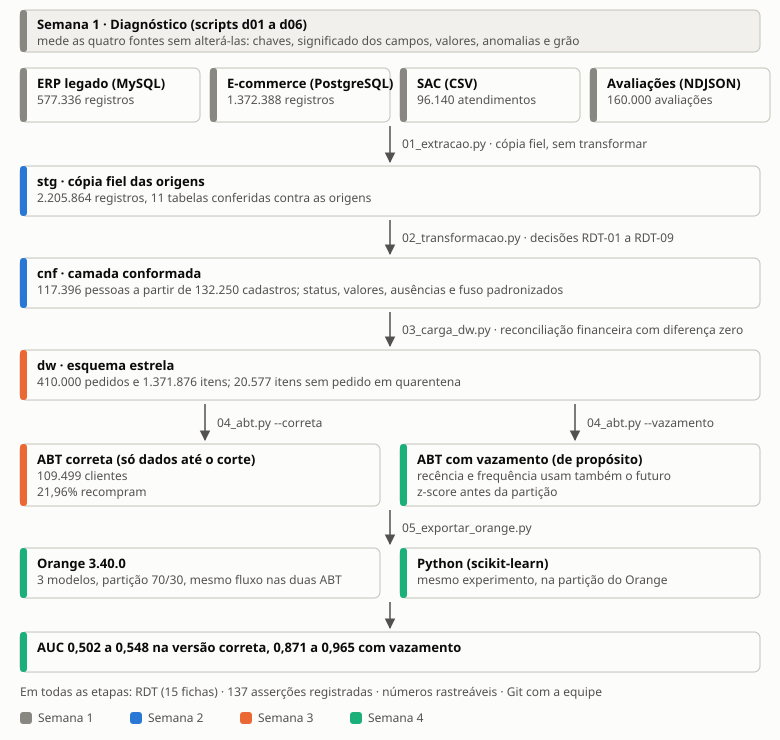
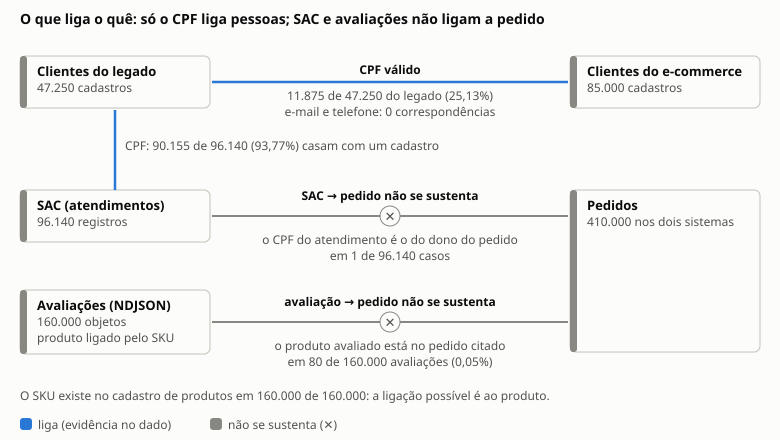
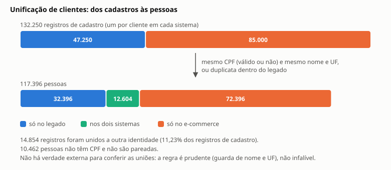
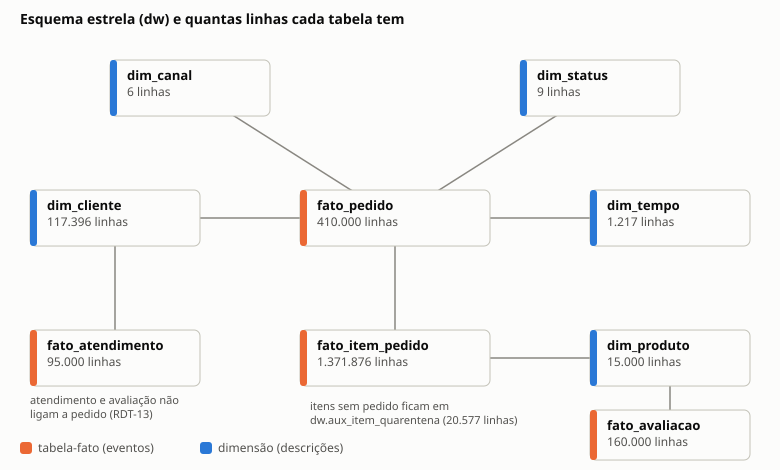
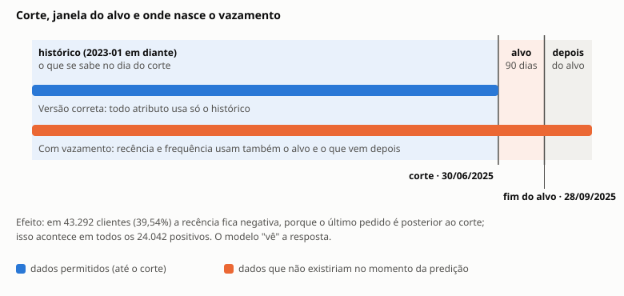
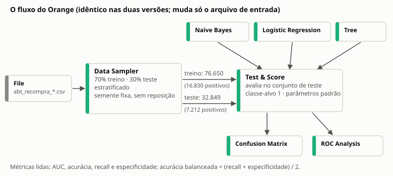
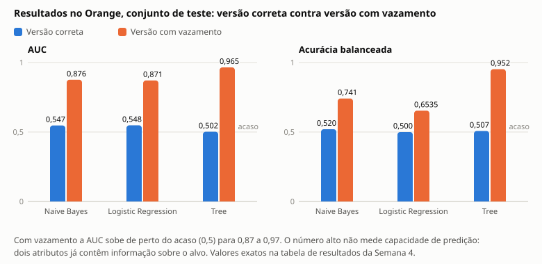

# Documentação do projeto ETL Mercatto

Material de estudo para a equipe (Gabriel, Lucas e Marcus) preparar a defesa. Para cada semana: **o que foi feito**, **como executar**, **código para estudar**, **resultados**,
**interpretação** e **para a defesa** (o que explicar em um minuto e perguntas prováveis). Todo número vem de arquivos gerados por scripts
versionados (`etl/diagnostico/`, em `saida/`); `diagnostico/verificar_documentacao.py` confere isso (ver a seção "Como esta documentação foi verificada").

## Resumo do projeto: como foi feito

**Em uma frase.** Integramos quatro fontes heterogêneas de uma rede de varejo num repositório analítico (`stg` → `cnf` → `dw` → `abt`), registramos cada decisão de transformação e usamos o resultado para medir, no Orange, quanto o vazamento de dados infla o desempenho de um modelo que prevê a recompra.



*Figura 1. O projeto inteiro numa página: cada seta é um script, cada cor é a semana em que a etapa foi feita, e os números vêm dos arquivos de `saida/`.*

**Passo a passo, em ordem.**

1. **Medir antes de mexer (Semana 1).** Seis scripts de diagnóstico mediram as fontes sem alterá-las (2.205.864 registros) e responderam a cinco perguntas: que chaves ligam as fontes, onde o significado dos campos diverge, o que os valores significam, quais anomalias existem e qual o grão das tabelas-fato.
2. **Extrair sem alterar e conformar (Semana 2).** A `stg` guarda a cópia fiel das origens; a `cnf` aplica as decisões: unificar clientes (os cadastros viram 117.396 pessoas), conformar status, valores, categorias, ausências e fuso. Cada decisão ganhou uma ficha do RDT.
3. **Carregar, reconciliar e montar a tabela de análise (Semana 3).** O DW em estrela (410.000 pedidos) foi carregado e reconciliado com as origens, com diferença zero. A ABT, com 109.499 clientes e 21,96% de positivos, foi construída só com dados até o corte e testada contra o DW cortado em 30/06/2025.
4. **Medir o efeito do vazamento (Semana 4).** Construímos uma segunda versão da ABT, de propósito, com vazamento, e rodamos o mesmo fluxo no Orange nas duas. Com vazamento, a AUC sobe de cerca de 0,5 para 0,87 a 0,97. O experimento foi repetido em Python, na mesma partição, e o RDT ganhou as fichas 14 e 15, a tabela-resumo e a reflexão.
5. **Provar a reprodutibilidade (fase final).** Apagamos o destino, rodamos o pipeline de novo e comparamos impressões digitais; criamos verificadores que procuram cada número dos textos nos arquivos gerados.

**Princípios que guiaram tudo.**

- **Evidência antes de decisão:** cada ficha do RDT traz o que o dado mostrava, as alternativas, a decisão, o que se perde, os registros afetados e a asserção que guarda a decisão.
- **Nada se corrige na origem:** as origens são somente leitura, e a `stg` é cópia fiel.
- **Verificação automática:** 137 asserções registradas no banco, todas aprovadas.
- **Todo número é rastreável:** sai de um script versionado e de um arquivo de `saida/`, e os verificadores conferem os textos.
- **Hipóteses não são conclusões:** relatamos o que o dado mostrou, inclusive quando a hipótese do roteiro caiu (por exemplo, o formato do CPF não muda com o tempo).

**Como o trabalho foi conduzido.** Em ciclos semanais, com o apoio do agente Claude Code sob regras permanentes (`CLAUDE.md`): não abrir os arquivos que revelam como as anomalias foram fabricadas, nunca escrever nas origens e deixar o Git com a equipe. Houve duas paradas obrigatórias: a equipe montou os fluxos no Orange (parada 4.3) e conferiu as fichas do RDT (parada 4.6). A equipe também decidiu os pontos abertos (alcance do teste do zero, dump no repositório, restauração das notas da Semana 1).

**Limites que declaramos.** O status do pedido na ABT é o do retrato dos dados, não o do corte; avaliações não ligam a cliente; a unificação de clientes não tem verdade externa para conferência; o Python não reproduz o Orange ao centésimo; e não provamos que o seed refaz as origens.

---

## Visão geral

**Pergunta do projeto.** Um cliente que comprou até 30/06/2025 recompra entre 01/07/2025 e 28/09/2025?

**Fontes.** Quatro, heterogêneas: o ERP legado (MySQL, tabelas `CLIENTES`, `PRODUTOS`, `PEDIDOS` e `ITENS_PEDIDO`), o e-commerce (PostgreSQL, esquema
`shop`), o CSV do SAC (atendimentos) e o NDJSON de avaliações de marketplace. As origens são **somente leitura**.

**Camadas** (cada uma é um esquema do banco `mercatto_dw`):

| Camada | O que guarda | Criada por |
|---|---|---|
| `stg` | cópia fiel das quatro fontes, sem filtro | `01_extracao.py` |
| `cnf` | dados conformados: clientes unificados, status, valores, datas e ausências tratados | `02_transformacao.py` |
| `dw` | esquema estrela (dimensões e fatos) | `03_carga_dw.py` |
| `abt` | tabela-base de análise: uma linha por cliente, com os atributos e o alvo | `04_abt.py` |

Depois da `abt`, `05_exportar_orange.py` grava os CSV que o Orange lê, e `diagnostico/experimento_python.py` repete o experimento em Python.

**Glossário mínimo.**

- *Corte*: 30/06/2025. Só dados até essa data podem virar atributo. *Alvo*: comprou na janela de 01/07/2025 a 28/09/2025.
- *Grão*: o que uma linha de uma tabela-fato representa.
- *RDT*: Registro de Decisões de Transformação. Cada ficha traz evidência, alternativas, decisão, o que se perde, registros afetados e a asserção que guarda a decisão.
- *Asserção*: verificação automática gravada em `qa.execucao_assercao`. Uma falha fica registrada e marcada `FALHA` no terminal, mas **não interrompe a etapa**; a exceção é a reconciliação financeira da etapa 3, que aborta se a diferença passar de 0,1%.
- *Vazamento*: o treino recebe informação sobre o alvo que não existiria no momento da predição.
- *Acurácia balanceada*: (recall + especificidade) / 2, com a classe 1 (recompra) como positiva.

**Onde está cada coisa.**

| Documento | Para quê |
|---|---|
| `README.md` (raiz) | mapa do repositório e execução |
| `ETL/docs/RDT.md` e `RDT.pdf` | as 15 decisões de transformação, com tabela-resumo e reflexão |
| `ETL/relatorio/semana1/notas_para_defesa.md` | conclusões da Semana 1 e decisões D1 a D10 com as alternativas descartadas |
| `ETL/relatorio/notas_para_defesa_semanas_2_4.md` | decisões D11 a D53 com as alternativas descartadas |
| `ETL/relatorio/semana4/resultados_experimento.md` e `.pdf` | resultado do experimento de vazamento |
| `ETL/relatorio/semana4/GUIA_ORANGE.md` | como montar os fluxos no Orange |
| `ETL/relatorio/PROGRESSO.md` | histórico por semana |
| `ETL/docs/DICIONARIO_ABT.md` | os atributos da tabela-base |

**Regra para todos os comandos:** rodar a partir da pasta `ETL/`, com o Python dentro do contêiner `etl`. Para subir o ambiente:

```bash
cd ETL
echo 'ESCALA=1.0' > .env
docker compose up -d --build
docker compose logs -f seed       # esperar "ambiente pronto."
```

---

## Semana 1 — Diagnóstico das fontes

### O que foi feito
Sem transformar nada, medimos as quatro fontes com seis scripts (`d01` a `d06`) e o perfilamento-modelo (`00_perfilamento.py`). O perfilamento usa só uma amostra (`LIMIT 200000`);
por isso todas as contagens do relatório foram refeitas em SQL sobre as tabelas inteiras. O relatório (`relatorio/semana1/diagnostico_semana1.pdf`) responde a cinco
perguntas: (a) que chaves ligam as fontes, (b) onde há heterogeneidade semântica, (c) o que significam os valores, (d) quais anomalias existem, (e) qual o grão das tabelas-fato.

### Como executar
```bash
docker compose exec etl python 00_perfilamento.py
for s in d01_volumes_periodos d02_chaves d03_semantica d04_valores d05_anomalias d06_grao; do
  docker compose exec etl python -m diagnostico.$s
done
```
Saídas em `saida/diagnostico/`. O verificador do relatório lê o texto pela entrada padrão (rodá-lo sem entrada apaga o resultado anterior):
`git show c50dbc2:ETL/relatorio/semana1/diagnostico_semana1.md | docker compose exec -T etl python -m diagnostico.verificar_relatorio`.

### Código para estudar
Todos os caminhos são relativos a `ETL/etl/`. A coluna "Estudar" diz o que ler primeiro.

| Arquivo | O que faz | Estudar |
|---|---|---|
| `config.py` | conexões somente leitura das origens e do DW; as datas analíticas (`DATA_CORTE`, `JANELA_ALVO_DIAS`, `DATA_FIM_ALVO`). Fornecido, não se altera | ler inteiro; é de onde vem o corte de 30/06/2025 |
| `diagnostico/comum.py` | funções compartilhadas: `leg` e `ecom` (consultas nas origens), `cpf_valido` (dígito verificador), `normaliza_texto`, `registrar` e `salvar_csv` (gravam os números em `saida/diagnostico/`), `Relatorio` | `cpf_valido` e `registrar`: por `registrar` todo número chega ao relatório |
| `00_perfilamento.py` | perfilamento-modelo fornecido, com amostra de `LIMIT 200000` | só para saber explicar por que ele não serve para contagens |
| `diagnostico/d01_volumes_periodos.py` | volumes de cada fonte e cobertura temporal | rápido |
| `diagnostico/d02_chaves.py` | pergunta (a): cobertura do CPF, e-mail, telefone e das referências do SAC e do NDJSON | o teste do CPF válido e a consistência entre o CPF do atendimento e o dono do pedido |
| `diagnostico/d03_semantica.py` | pergunta (b): os cinco casos de heterogeneidade semântica | o caso de `CANCELADO` e o de `SITE` |
| `diagnostico/d04_valores.py` | pergunta (c): `flags_sql` e `por` testam as fórmulas H1 a H6 em SQL, sobre todos os pedidos | **prioridade alta**: é a prova de que `total_amount` não inclui o frete |
| `diagnostico/d05_anomalias.py` | pergunta (d): `reg` registra anomalias de uma fonte só ("agora"); `reg2` registra as que dependem de integrar, com limite inferior e superior ("depois") | entender por que o "depois" tem dois limites |
| `diagnostico/d06_grao.py` | pergunta (e): verificações que sustentam o grão | a colisão de ids entre os dois sistemas |
| `diagnostico/verificar_relatorio.py` | confere os números do relatório contra `numeros.json` | só para saber que existe |

### Resultados
- **Volume:** 2.205.864 registros (577.336 no legado, 1.372.388 no e-commerce, 96.140 atendimentos e 160.000 avaliações).
- **Chave de clientes:** só o CPF liga os cadastros. O CPF válido casa 11.875 dos 47.250 clientes do legado (25,13%); e-mail e telefone casam 0.
- **SAC e avaliações ligam ao cliente pelo CPF, não ao pedido.** O CPF do atendimento é o do dono do pedido em 1 de 96.140 casos; o CPF do SAC casa com algum cadastro em 93,77%.
- **Valores:** `total_amount` do e-commerce é a mercadoria líquida, sem frete (a fórmula bruto − desconto de linha vale em 100% dos pedidos). `VALOR_TOTAL` do legado é a mercadoria líquida mais o frete: vale em 96,92% dos pedidos e em 100% quando o desconto `-1` é lido como zero.
- **Status:** `CANCELADO` responde por 12,13% dos pedidos do legado e provavelmente reúne dois significados que o e-commerce separa (cancelado e pagamento recusado).
- **Anomalias dentro de uma fonte:** 2.250 pares de clientes duplicados no legado; 1.025 entregas com data `1900-01-01`; 20.577 itens sem pedido (5.868 no legado e 14.709 no e-commerce).
- **Anomalias que só aparecem na integração:** 78 pedidos (limite superior) trocam de lado do corte ou do fim do alvo conforme o fuso. Entre os clientes de CPF comum, 84,85% compraram nos dois sistemas antes do corte; sem unificar, 32,26% teriam ao menos uma linha da ABT com o rótulo errado.
- **Grão:** `fato_pedido` tem uma linha por pedido de um sistema, chave (sistema, id). Os 130.000 ids do legado também existem no e-commerce, então ignorar o sistema daria 280.000 pedidos em vez de 410.000.



*Figura 2. Onde há ligação de verdade no dado (azul) e onde a ligação sugerida pelo dicionário não se sustenta (cinza).*

### Interpretação
O diagnóstico mostra que **o dado não é confiável como vem**: o mesmo rótulo ("valor total", "cancelado") significa coisas diferentes em cada sistema, e as ligações que o dicionário sugere (SAC → pedido) não se sustentam. Cada achado vira uma decisão da Semana 2.
O mais importante para o alvo é a identidade do cliente: quem compra nos dois sistemas só é visto por inteiro depois de unificar, e é isso que faz a recompra ser medida direito.

### Para a defesa
- **Em um minuto:** "Medimos as quatro fontes sem alterá-las e descobrimos que os rótulos enganam: o total do legado inclui frete e o do e-commerce não, e o SAC liga ao cliente, não ao pedido."
- **Como vocês sabem que `total_amount` não inclui frete?** Testamos seis fórmulas contra todos os pedidos, em SQL: só "bruto − desconto de linha" bate em 100% dos pedidos do e-commerce.
- **Por que não usar e-mail para ligar clientes?** A interseção entre os dois sistemas é 0.
- **Por que a amostra do `00_perfilamento.py` não basta?** Ela trunca três tabelas; contagens e reconciliações precisam da tabela inteira.

### Resumo da semana
**Semana 1: medir sem transformar.** Seis scripts mediram as quatro fontes (2.205.864 registros) e mostraram que o dado não pode ser integrado às cegas.
Só o CPF liga cadastros (casa 25,13% dos clientes do legado); o SAC e as avaliações ligam ao cliente, não ao pedido; `VALOR_TOTAL` inclui o frete e `total_amount` não.
Apareceram 2.250 pares de clientes duplicados, 20.577 itens sem pedido e 78 pedidos cujo lado do corte depende do fuso.
Esses achados são a matéria-prima das decisões das semanas seguintes. **Para levar:** o diagnóstico não corrige nada; ele dá a evidência de cada decisão.

---

## Semana 2 — Extração e conformação

### O que foi feito
- **`01_extracao.py`:** copia as quatro fontes para o esquema `stg`, sem filtro, e confere cada contagem com a origem. É carga completa, porque as origens não têm coluna de atualização (RDT-01).
- **`02_transformacao.py`:** produz o esquema `cnf`. Unifica clientes dos dois sistemas e funde duplicatas do legado (RDT-02 e 03); conforma status (RDT-04), valores (RDT-05 e 06), categorias de produto (RDT-07), ausências (RDT-08) e fuso (RDT-09); liga SAC e avaliações.
- **`docs/RDT.md`:** fichas RDT-01 a RDT-09, cada uma com as seis partes exigidas.

### Como executar
```bash
docker compose exec etl python 01_extracao.py
docker compose exec etl python 02_transformacao.py
docker compose exec etl python -m diagnostico.e01_conferencia_stg      # stg contra o diagnóstico da Semana 1
docker compose exec etl python -m diagnostico.rdt_registros_afetados   # números do RDT
docker compose exec etl python -m diagnostico.renderiza_rdt            # gera saida/rdt/RDT.md
cp saida/rdt/RDT.md docs/RDT.md
```
Tempos medidos no teste do zero: `01_extracao` 24 s e `02_transformacao` 471 s (pouco menos de oito minutos).

### Código para estudar
| Arquivo | O que faz | Estudar |
|---|---|---|
| `01_extracao.py` | `extrai_mysql`, `extrai_postgres`, `extrai_sac` e `extrai_avaliacoes` copiam cada fonte para a `stg` (colunas de procedência `_fonte`, `_extraido_em` e `_linha_origem`); `cria_tabela` recria a tabela; `verifica` e `confere_colunas` comparam a `stg` com a origem | `verifica` (a prova de que nada foi perdido) e a regra de não transformar nada na `stg` |
| `qualidade/assercoes.py` | fornecido: a classe `Suite` (`igual`, `entre`, `sem_nulos`, `unico`, `dominio`, `cardinalidade_preservada`, `sem_orfaos`); `registrar` grava em `qa.execucao_assercao` | entender, porque toda etapa o usa; uma falha **não interrompe** a etapa |
| `02_transformacao.py` | o coração da semana. `unifica_clientes` (cada pessoa é um componente conexo de um grafo de pareamento: duplicata do legado, CPF válido com nome, CPF inválido com nome e UF) · `conforma_status` · `conforma_valores` · `conforma_categorias` · `trata_datas_e_ausencias` · `monta_pedido` (junta as decisões na tabela de pedidos conformada) · `liga_sac_e_avaliacoes` | **prioridade alta**: `unifica_clientes` e `conforma_valores`; depois `trata_datas_e_ausencias` |
| `diagnostico/e01_conferencia_stg.py` | confere a contagem da `stg` contra o diagnóstico da Semana 1 | rápido |
| `diagnostico/rdt_registros_afetados.py` | calcula o item (e) das fichas: registros afetados por cada decisão, em SQL sobre tabelas inteiras | ver como um número do RDT nasce |
| `diagnostico/renderiza_rdt.py` e `rdt/RDT.template.md` | geram `docs/RDT.md` trocando cada marcador `{{chave}}` pelo número do JSON; a geração falha se uma chave não existir | entender por que "nenhum número foi digitado à mão" |

Mapa decisão → função: RDT-02 e 03 em `unifica_clientes`; RDT-04 em `conforma_status`; RDT-05 e 06 em `conforma_valores`; RDT-07 em `conforma_categorias`; RDT-08 e 09 em `trata_datas_e_ausencias`.

### Resultados
- **Extração:** a `stg` tem as mesmas contagens das origens nas 11 tabelas (`saida/extracao/contagens_stg.csv`), 32 asserções e 0 falhas.
- **Clientes:** os 132.250 registros de cadastro viram 117.396 pessoas: 12.604 nos dois sistemas, 72.396 só no e-commerce e 32.396 só no legado. 14.854 registros foram unidos a outra identidade (11,23% dos registros), 2.250 deles duplicatas do legado.
- **Status:** 52.177 pedidos são cancelados (12,73% dos pedidos). Cancelado conta como não-compra.
- **Valor:** `valor_total` = mercadoria − desconto + frete nos dois sistemas. Isso difere do `total_amount` cru em 279.984 pedidos do e-commerce (99,99%), justamente por acrescentar o frete.
- **Fuso:** a régua é a hora de Brasília; com UTC, 78 pedidos (0,02%) trocariam de lado do corte ou do fim do alvo.
- **Transformação:** 46 asserções e 0 falhas.



*Figura 3. Dos cadastros às pessoas: as barras têm a mesma escala, então o encolhimento é real.*

### Interpretação
As decisões da Semana 2 são de **julgamento**: unir por CPF (válido ou não) com guarda de nome e UF reduz homônimos, mas não há verdade externa para conferir as 14.854 uniões. Já a decisão de somar o frete ao total do e-commerce **não** é um julgamento no mesmo sentido: o dado prova a fórmula, e só falta uniformizá-la.
Cada decisão custa algo (por exemplo, o motivo de cancelamento do legado se perde) e o RDT registra isso.

### Para a defesa
- **Em um minuto:** "Conformamos as fontes numa camada `cnf` sem apagar a cópia fiel `stg`; cada decisão tem uma ficha com evidência, alternativas, o que se perde e a asserção que a protege."
- **Por que unir clientes por CPF e não por e-mail?** O e-mail não casa nenhum registro entre os sistemas; o CPF casa e, nos pares, o nome concorda em quase todos os casos.
- **Por que o frete foi somado ao total do e-commerce, e não retirado do legado?** Porque o DDL define `valor_total` como mercadoria + frete − desconto, e retirar o frete do legado tiraria da ABT um atributo real (RDT-05).
- **O que se perde ao unificar?** Pessoas sem CPF (10.462) não são pareadas; a decisão é prudente, e não perfeita.

### Resumo da semana
**Semana 2: extrair sem alterar e conformar com decisões registradas.** A `stg` guarda a cópia fiel das 11 tabelas de origem (32 asserções, 0 falhas), e a `cnf` as conforma (46 asserções, 0 falhas).
Os 132.250 registros de cadastro viram 117.396 pessoas; 52.177 pedidos são cancelados e contam como não-compra; `valor_total` passa a ter a mesma fórmula nos dois sistemas; a régua de tempo é a hora de Brasília.
Cada decisão tem uma ficha (RDT-01 a RDT-09) com evidência, alternativas, o que se perde e a asserção que a guarda.
**Para levar:** unir clientes é julgamento sem verdade externa (14.854 registros unidos a outra identidade), e por isso a decisão é prudente e documentada.

---

## Semana 3 — Carga do DW, reconciliação e ABT

### O que foi feito
- **`03_carga_dw.py`:** carrega o esquema estrela a partir de `cnf`, põe em quarentena os itens sem pedido e **reconcilia** as somas financeiras com as origens (RDT-10 a 13).
- **`04_abt.py --correta`:** monta `abt.recompra_90d`, com todos os atributos calculados só com dados até o corte, e testa isso (RDT-14).
- Dump do DW em `entregas/dw_semana3.sql.gz`.

### Como executar
```bash
docker compose exec etl python 03_carga_dw.py          # dw + reconciliação (56 s no teste do zero)
docker compose exec etl python 04_abt.py --correta     # abt.recompra_90d (54 s)
```

### Código para estudar
| Arquivo | O que faz | Estudar |
|---|---|---|
| `03_carga_dw.py` | `carrega_dim_tempo`, `limpa_dw`, `carrega_dimensoes`, `carrega_fato_pedido`, `carrega_fato_item` (itens sem pedido vão para a quarentena), `carrega_fatos_auxiliares` (atendimentos e avaliações) e `reconcilia` | **prioridade alta**: `reconcilia` (a mesma fórmula nos dois lados; aborta se a diferença passar de 0,1%) e o tratamento dos itens órfãos em `carrega_fato_item` |
| `04_abt.py` (parte correta) | `sql_atributos` (o SQL dos atributos, sempre com filtro de data até o corte), `monta_atributos_corretos`, `copia_no_corte` (cria o esquema `dw_corte`: o DW como estaria em 30/06/2025), `verifica_correta` (recalcula o alvo de forma independente em pandas e compara os atributos com os recalculados no `dw_corte`), `grava_correta`, `grava_resumo` | **prioridade alta**: `copia_no_corte` e `verifica_correta`, que são a prova de ausência de vazamento; e o SQL do alvo (`SQL_ALVO`) |
| `docs/DICIONARIO_ABT.md` e `saida/abt/dicionario_atributos.csv` | cada atributo da ABT, sua regra e o que significa estar ausente | saber explicar cada atributo |
| `diagnostico/rdt_registros_afetados.py` | números das fichas RDT-10 a RDT-14 | consultar |



*Figura 4. O esquema estrela e o tamanho de cada tabela. Atendimento e avaliação ligam a cliente e a produto, não a pedido.*

### Resultados
- **Carga:** `fato_pedido` tem 410.000 linhas (130.000 do legado e 280.000 do e-commerce); `fato_item_pedido`, 1.371.876 (98,52% dos itens); `fato_atendimento`, 95.000; `fato_avaliacao`, 160.000. 20.577 itens ficaram em quarentena (1,48%) por não terem pedido. Nenhum pedido ficou sem cliente. 27 asserções, 0 falhas.
- **Reconciliação financeira:** diferença **zero** nos dois sistemas: R$ 281.084.957,13 no legado e R$ 745.850.860,33 no e-commerce. Se a comparação fosse com o `total_amount` cru, apareceria uma diferença falsa de R$ 10.991.760,38 (o frete).
- **ABT:** 109.499 clientes, 24.042 positivos (21,96%), 14 atributos, 12 asserções e 0 falhas. 3.087 clientes só têm pedidos cancelados até o corte (2,82%) e ficam com os atributos "efetivos" nulos.
- **Ausência de vazamento na versão correta:** os atributos foram recalculados com o DW "como estava" em 30/06/2025, e os valores coincidem (asserção `atributos: valores que mudam se o DW for cortado em 30/06/2025`). O teste não cobre o status do pedido, que é o do retrato dos dados (D40).

### Interpretação
A reconciliação zero só vale porque a **mesma fórmula** foi aplicada nos dois lados. Ela prova que a carga não perdeu nem inventou valor, não que a fórmula esteja certa; a fórmula vem das evidências da Semana 1.
A taxa de 21,96% de positivos mostra um alvo desbalanceado: isso explica por que, na Semana 4, a acurácia simples engana.
Há **limites declarados** da ABT: o status do pedido é o do retrato dos dados, não o do dia do corte (D40), e o grupo de clientes só com cancelados fica na população (D38).

### Para a defesa
- **Em um minuto:** "Carregamos a estrela, reconciliamos o dinheiro com a origem (diferença zero) e construímos a ABT mostrando, contra o DW cortado em 30/06, que nenhum atributo muda quando os registros do futuro são removidos. O status do pedido é o do retrato dos dados, e isso é um limite declarado."
- **O que é a quarentena?** Itens cujo pedido não existe: ficam numa tabela à parte, com o motivo, fora dos fatos.
- **Por que `fato_pedido` mantém os cancelados?** O grão é "um pedido, qualquer status", e a reconciliação exige todos; excluir os não efetivos é decisão da ABT.
- **Como se mostra que a ABT não vaza?** Recalculando cada atributo com o DW restrito a 30/06/2025 e exigindo valores iguais. Cuidado com o alcance: o teste usa o mesmo SQL nos dois DW e não cobre o status do pedido, que é o do retrato dos dados (D40); por isso dizemos "não encontramos uso de registros posteriores ao corte", e não "provamos que não há nenhum vazamento".

### Resumo da semana
**Semana 3: carregar, reconciliar e montar a tabela de análise.** O DW tem 410.000 pedidos e 1.371.876 itens; 20.577 itens sem pedido ficam em quarentena (27 asserções, 0 falhas).
A reconciliação financeira dá diferença zero nos dois sistemas. A ABT tem 109.499 clientes, 14 atributos e 24.042 positivos (21,96%), e passou no teste de equivalência: cada atributo coincide com o recalculado no DW cortado em 30/06/2025 (12 asserções, 0 falhas).
**Para levar:** o alvo é desbalanceado, e os limites da ABT estão declarados (status do retrato, clientes só com cancelados, avaliações sem ligação ao cliente).

---

## Semana 4 — Modelar, comparar e defender

### O que foi feito
- **Duas versões da ABT.** A *correta* e a *com vazamento*, em que `recencia_dias` e `frequencia_pedidos` são calculados sobre a base inteira (inclusive os pedidos da janela do alvo) e `valor_monetario` é padronizado (z-score) antes da partição treino/teste. A *sutil* tem só a padronização antes da partição.
- **Orange.** Dois fluxos idênticos: amostragem estratificada 70/30, Naive Bayes, Logistic Regression e Tree em *Test & Score*, *Confusion Matrix* e *ROC Analysis*. Só o arquivo de entrada muda (versão 3.40.0).
- **Python.** O mesmo experimento, na partição exportada do Orange, mais a versão sutil e um controle (z-score calculado só no treino).
- **Relatório de resultados**, tabela-resumo e reflexão do RDT (fichas 14 e 15).



*Figura 5. Onde nasce o vazamento: a versão correta só enxerga o histórico; a versão com vazamento enxerga também o alvo.*


*Figura 6. O fluxo que roda nas duas versões. A única diferença entre os dois fluxos é o arquivo lido pelo widget File.*

### Como executar
```bash
docker compose exec etl python 04_abt.py --correta --vazamento --vazamento-sutil
docker compose exec etl python 05_exportar_orange.py                      # saida/abt_recompra_{correta,vazamento}.csv
# montar os dois fluxos no Orange: relatorio/semana4/GUIA_ORANGE.md
docker compose exec etl python -m diagnostico.experimento_python         # ~20 s -> saida/experimento/
docker compose exec etl python -m diagnostico.experimento_sensibilidade   # ~5 min
```
O Python lê a partição do Orange (`particao_orange_treino.csv` e `particao_orange_teste.csv`, copiadas para `saida/experimento/`, porque o contêiner não enxerga `relatorio/`).

### Código para estudar
| Arquivo | O que faz | Estudar |
|---|---|---|
| `04_abt.py` (parte do vazamento) | `sql_dois_atributos_sobre_a_base_inteira` (recência e frequência sem filtro de data), `monta_atributos_com_vazamento`, `padroniza_antes_da_particao` (z-score global de `valor_monetario`), `constroi_vazamento`, `verifica_vazamento` (as asserções marcadas "(intencional)" confirmam que o vazamento existe) e `dicionario_vazamento`; as opções `--vazamento` e `--vazamento-sutil` | **prioridade alta**: a diferença entre os três vazamentos |
| `05_exportar_orange.py` | fornecido: `tipo_orange` e `exporta` gravam o CSV com o cabeçalho de três linhas do Orange (nomes, tipos e papéis) | entender os papéis `class` e `meta` |
| `diagnostico/experimento_python.py` | `PreProcessador` (indicadores, imputação pela média), `NaiveBayesOrange` (reimplementa o Naive Bayes do Orange), `treina_e_avalia` (três modelos mais a variante padronizada), `auc_univariada` e `main` (partição do Orange, versões, controle, comparação) | **prioridade alta**: `treina_e_avalia` e `main` |
| `diagnostico/experimento_sensibilidade.py` | testa se a Logistic Regression converge e como o tamanho da folha muda a árvore | saber explicar por que o Python não bate com o Orange |
| `diagnostico/verificar_resultados.py` | confere os números do relatório de resultados | só para saber que existe |
| `relatorio/semana4/GUIA_ORANGE.md` | passo a passo dos dois fluxos (não é código, mas é o que vocês executam) | saber refazer um fluxo do zero |

### Resultados
Treino com 76.650 clientes (16.830 positivos) e teste com 32.849 (7.212 positivos), a mesma partição nos dois fluxos.

| Modelo | AUC correta | AUC vazamento | Acurácia balanceada correta | Acurácia balanceada vazamento |
|---|---|---|---|---|
| Naive Bayes | 0,547 | 0,876 | 0,520 | 0,741 |
| Logistic Regression | 0,548 | 0,871 | 0,500 | 0,6535 |
| Tree | 0,502 | 0,965 | 0,507 | 0,952 |

(Orange, `metricas_orange.csv`.) O Python dá resultados da mesma ordem (por exemplo, AUC da Tree de 0,505 na correta e 0,959 no vazamento).



*Figura 7. AUC e acurácia balanceada nas duas versões. A linha de 0,5 marca o desempenho de um acaso.*

- **O vazamento é medido:** em 43.292 clientes (39,54%) a recência fica negativa, porque o último pedido é posterior ao corte, e isso ocorre em todos os 24.042 positivos.
- **Vazamento sutil:** não deixou rastro. Naive Bayes e Tree dão a mesma AUC da versão correta; a Logistic Regression sem convergência varia 0,014, mas o controle sem vazamento varia quase o mesmo (0,011), e com a otimização convergida as versões ficam iguais.
- **Detecção:** na versão com vazamento, `recencia_dias` sozinho tem AUC 0,797 e `frequencia_pedidos` 0,708; nenhum outro passa de 0,536.

### Interpretação
1. **A versão correta quase não prevê** (AUC perto de 0,5): só com histórico de compras, prever a recompra é difícil. O experimento mede o **efeito do vazamento**, não a qualidade de um bom modelo.
2. **A versão com vazamento parece excelente porque trapaceia:** os dois atributos já contêm informação sobre o alvo. O número alto não é capacidade de predição.
3. **O vazamento sutil existe, mas não aparece nas métricas.** Isso ensina que métrica boa ou ruim não prova nem refuta vazamento; só a revisão do código ou da linhagem o revela.
4. **Python e Orange diferem em detalhes** (Logistic Regression e Tree), com explicações plausíveis, não testadas: o Orange para a árvore por maioria de 95%, e o scikit-learn do contêiner não converge a regressão sem normalização.

### Para a defesa
- **Em um minuto:** "Construímos a ABT duas vezes e só mudamos o arquivo no Orange: com vazamento, a AUC sobe de cerca de 0,5 para 0,87 a 0,97, porque dois atributos usam pedidos posteriores ao corte."
- **Pergunta (c) do roteiro — se recebesse só o resultado com vazamento, como descobriria que está errado?**
    1. Plausibilidade: AUC de 0,959 numa árvore só com histórico de compras é suspeita.
    2. AUC de cada atributo isolado (executado): `recencia_dias` sozinho tem 0,797, e dois atributos concentram o poder.
    3. Auditoria de linhagem (não executada sobre o resultado, mas é o que fizemos na construção): recalcular os atributos com o DW "cortado" e comparar.
    4. Validação fora do tempo e ablação (não executadas).
- **O vazamento sutil teve efeito?** Não nas métricas; ele só se acha lendo o código (ordem entre padronizar e particionar). Cuidado: dizer "não teve efeito" não é dizer "não existe".
- **Por que acurácia balanceada?** Com 21,96% de positivos, um modelo que sempre prevê "não recompra" teria acurácia alta e recall zero.
- **Por que o Python não bate com o Orange?** São hipóteses não testadas (parada da árvore e convergência); a conclusão (a) vale nos dois.

### Resumo da semana
**Semana 4: medir o efeito do vazamento.** Dois fluxos idênticos no Orange, com só o arquivo de entrada diferente: com vazamento, a AUC sobe de cerca de 0,5 para 0,87 a 0,97, porque dois atributos usam pedidos posteriores ao corte (a recência fica negativa em todos os 24.042 positivos).
O vazamento sutil (padronizar antes de particionar) existe, mas não deixou rastro nas métricas. O experimento em Python, na mesma partição, confirma as conclusões e difere do Orange em detalhes explicados por hipóteses não testadas.
**Para levar:** métrica alta não prova que o modelo é bom, e métrica igual não prova que não há vazamento; só a revisão da linhagem do dado e do código decide.

---

## Fase final — reprodutibilidade e entrega

### O que foi feito
- **Teste do zero:** apagamos o destino (os 5 esquemas do `mercatto_dw` e os arquivos gerados), reaplicamos o DDL e rodamos o pipeline inteiro, comparando impressões digitais (`diagnostico/f1_hashes.py`).
- **Verificadores de números:** `verificar_relatorio.py` (Semana 1), `verificar_resultados.py` (relatório de resultados) e `verificar_documentacao.py` (este documento).
- **README, PDFs** do RDT e do relatório de resultados, e o dump comprimido do DW.

### Como executar
```bash
docker compose exec etl python -m diagnostico.f1_hashes antes      # antes de apagar o destino
# apagar o destino, reaplicar o DDL e rodar o pipeline (ver README, seção 2)
docker compose exec etl python -m diagnostico.f1_hashes depois
docker compose exec etl python -m diagnostico.f1_hashes comparar
```

### Código para estudar
| Arquivo | O que faz | Estudar |
|---|---|---|
| `diagnostico/f1_hashes.py` | `coleta` calcula as impressões digitais (hash dos arquivos; por tabela, linhas e soma de hashes das linhas), `main` grava `antes` e `depois` e `comparar` os compara | por que a soma de hashes não depende da ordem das linhas |
| `diagnostico/verificar_documentacao.py` | procura cada número deste documento nos arquivos de `saida/` | só para saber que existe |
| `diagnostico/gera_figuras.py` | gera as figuras deste guia (SVG) lendo os arquivos de `saida/` | ver como cada número da figura vem de um arquivo |

### Resultados
O teste do zero comparou 196 itens: 185 idênticos e 11 diferentes (`saida/diagnostico/f1_resumo.csv`). Os 11 diferentes são as tabelas da `stg`, que guardam a hora da extração (`_extraido_em`); numa segunda extração, sem essa coluna, as tabelas da `stg` são idênticas (`f1_resumo_stg_a_stg_b.csv`). Todas as tabelas de `cnf`, `dw` e `abt`, os 15 arquivos gerados e as 137 asserções registradas são idênticos.

### Interpretação
O pipeline é **reproduzível a partir das origens**. Não provamos que o seed reproduz as origens (não derrubamos os volumes) e a `stg` não é idêntica byte a byte, por construção.

### Para a defesa
- **Como se sabe que o pipeline é reexecutável?** Apagamos o destino, rodamos tudo de novo e comparamos hashes de arquivos e de tabelas.
- **O que não foi provado?** O seed das origens e a identidade byte a byte da `stg`.

### Resumo da fase
**Fase final: provar que se reproduz e que os números têm fonte.** O teste do zero comparou 196 itens depois de apagar o destino e rodar o pipeline: 185 idênticos e 11 diferentes só pela hora da extração (`_extraido_em`).
Três verificadores conferem os números dos relatórios contra arquivos de `saida/`, e os PDFs do RDT, do relatório de resultados e deste guia estão gerados.
**Para levar:** o pipeline é reproduzível a partir das origens; não provamos que o seed refaz as origens.

---

## Como esta documentação foi verificada

Todo número do texto é procurado nos arquivos de `saida/` por `diagnostico/verificar_documentacao.py`:

```bash
docker compose exec -T etl python -m diagnostico.verificar_documentacao < docs/DOCUMENTACAO.md
```

O resultado fica em `saida/diagnostico/verificacao_documentacao.md`, com a origem de cada número. Se alterarem o texto, rodem o verificador de novo.

As **figuras** não passam por esse verificador (ele lê texto, não imagem). Por isso elas não são desenhadas à mão: `diagnostico/gera_figuras.py` as gera como SVG a partir dos mesmos arquivos de `saida/`.

```bash
docker compose exec etl python -m diagnostico.gera_figuras
mkdir -p docs/figuras && cp saida/figuras/*.svg docs/figuras/
```

## Limitações a saber declarar

- O Orange foi rodado uma vez por versão, e o Python não o reproduz ao centésimo.
- A versão sutil e o controle não passaram pelo Orange.
- A ABT guarda o status do pedido do retrato dos dados, não o do corte (D40), e inclui clientes só com cancelados (D38).
- As avaliações não ligam a cliente (D30); por isso o atributo `nota_media_avaliacoes` ficou fora da ABT.
- A unificação de clientes não tem verdade externa para conferência.
